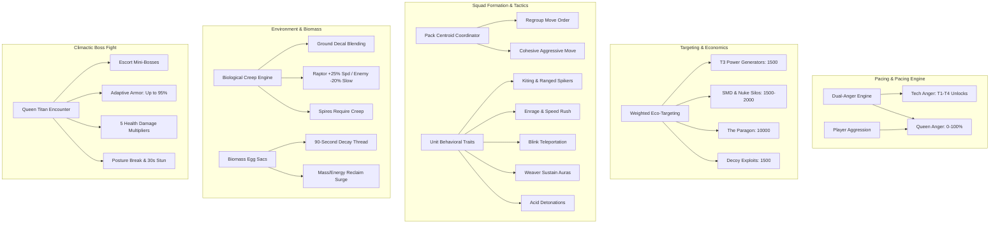

# Raptor Faction: Master Architecture & Porting Technical Reference

This document serves as the master technical blueprint and index for porting the **Beyond All Reason (BAR) Raptor Defense** game mode into Supreme Commander: Forged Alliance Forever (FAF).

---

## 1. System Component Map

---

## 2. Specification Document Index

Detailed engineering blueprints have been generated for each subsystem:

1. [**RAPTOR_TARGETING_AND_WEIGHTS.md**](file:///e:/Games/FAFMods/docs/RAPTOR_TARGETING_AND_WEIGHTS.md)
   * Full FAF unit categorization table.
   * Economy weight values from T1 Mex to Paragon.
   * Lua weighted random target picker algorithm.
   * Decoy Commander trap exploitation.

2. [**RAPTOR_ANGER_AND_PACING.md**](file:///e:/Games/FAFMods/docs/RAPTOR_ANGER_AND_PACING.md)
   * Mathematical formulations for Tech Anger and Queen Anger.
   * Player aggression triggers (Hive/Turret kills) and passive decay.
   * The Extinction Retaliation trigger ($\le 1$ hive remaining).
   * Offsetting BAR unit XP with the battle-tested **FAF Master Overhaul in-game stat modifying engine** (`BuffBlueprint` HP, `OnDamage` multiplier, `SetSpeedMult`, `ChangeMaxRadius`, `SetRateOfFire`, `SetRegenRate`).

3. [**RAPTOR_SQUAD_TACTICS_AND_BEHAVIORS.md**](file:///e:/Games/FAFMods/docs/RAPTOR_SQUAD_TACTICS_AND_BEHAVIORS.md)
   * Platoon pack centroid cohesion and regrouping algorithm.
   * Behavioral trait specifications: Skirmish (kite), Coward (dodge), Berserk (charge), Spectre (blink), Healer (auras), Kamikaze (suicide).
   * Weapon traits and friendly fire rules.

4. [**RAPTOR_CREEP_AND_BIOMASS.md**](file:///e:/Games/FAFMods/docs/RAPTOR_CREEP_AND_BIOMASS.md)
   * Evaluation of `/mods/RaptorFaction/lua/RaptorCreep.lua`.
   * Terrain decal projection, global node tracking, and buff/debuff fields.
   * Creep requirement for defensive spire placement.
   * Biomass Raptor Egg feature drops and the 90-second rotting decay thread.

5. [**RAPTOR_QUEEN_BOSS_SEQUENCE.md**](file:///e:/Games/FAFMods/docs/RAPTOR_QUEEN_BOSS_SEQUENCE.md)
   * Awakening sequence, Matriarch escort squad, and global map visibility.
   * Dynamic Adaptive Resistance algorithm (countering single-unit spam up to $95\%$).
   * 5-tier health phase damage scaling ($2\times$ incoming early, down to $0.25\times$ with $2\times$ outbound enrage).
   * Posture stagger meter and 30-40s vulnerability stun window.
   * Anti-cheese protections (Overcharge / Ramming crash clamps).

6. [**RAPTOR_LOBBY_SETTINGS.md**](file:///e:/Games/FAFMods/docs/RAPTOR_LOBBY_SETTINGS.md)
   * Lobby options schema (`options.lua`) for FAF.
   * Baseline parameters comparison table from Very Easy to Epic.
   * Dynamic player count scaling formula ($+25\%$ wave and hive scaling per human player).

---

## 3. Implementation Roadmap & Milestones

| Stage | Milestone | Primary Files Involved | Status |
| :---: | :--- | :--- | :---: |
| **Stage 1** | **Unit Models & Animations** | SCM models, SCA walk/fly cycles, XACT audio banks | **COMPLETE** |
| **Stage 2** | **Creep Territory System** | `/lua/RaptorCreep.lua`, decal textures | **COMPLETE** |
| **Stage 3** | **Biomass Egg Reclaim** | `/env/props/raptor_egg_*.bp`, `OnKilled` drop hook | **READY FOR SIM** |
| **Stage 4** | **Targeting & Platoon AI** | `/lua/RaptorTargeting.lua`, `/lua/RaptorPlatoonAI.lua` | **SPEC DEFINED** |
| **Stage 5** | **Anger Engine & Waves** | `/lua/RaptorSpawner.lua`, `/lua/RaptorStats.lua` | **SPEC DEFINED** |
| **Stage 6** | **Queen Boss Encounter** | `XRA0401_script.lua`, `/lua/QueenAdaptiveResistance.lua` | **SPEC DEFINED** |
| **Stage 7** | **Lobby Options & UI** | `/mods/RaptorFaction/options.lua`, HUD status widgets | **SPEC DEFINED** |
