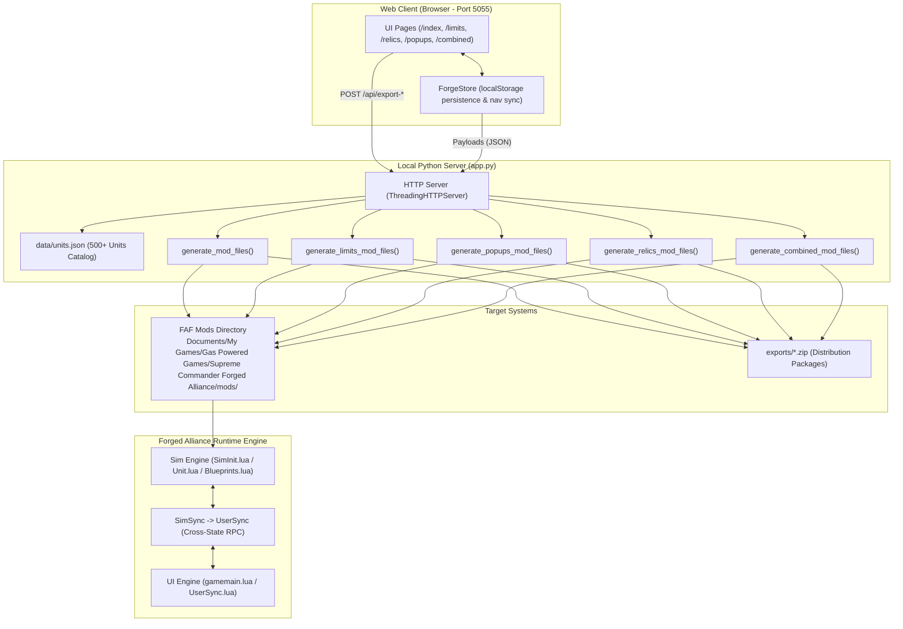

# FAF Mod Forge & Ecosystem — Comprehensive Project Map

> **Comprehensive Architectural Guide & Developer Manual**  
> Covers the full ecosystem: Web Application, Mod Generation Pipeline, Unit Database, FAF Engine Hooking Architecture, and step-by-step instructions for extending every layer of the system.

---

## Table of Contents
1. [Project Overview & Mission](#1-project-overview--mission)
2. [High-Level Architecture & Data Flow](#2-high-level-architecture--data-flow)
3. [File & Directory Breakdown](#3-file--directory-breakdown)
4. [Forged Alliance (FAF) Engine Integration](#4-forged-alliance-faf-engine-integration)
5. [Core Modules Deep Dive](#5-core-modules-deep-dive)
   - [Module 1: Unit Stat Tweaker & Buffs](#module-1-unit-stat-tweaker--buffs)
   - [Module 2: Unit Limits Engine](#module-2-unit-limits-engine)
   - [Module 3: Relic Objectives System](#module-3-relic-objectives-system)
   - [Module 4: Tactical Popups & Announcements](#module-4-tactical-popups--announcements)
   - [Module 5: Combined Master Overhaul](#module-5-combined-master-overhaul)
   - [Module 6: Boss Adaptive Resistance Engine (BAR-Style Mechanic)](#module-6-boss-adaptive-resistance-engine-bar-style-mechanic)
   - [Module 7: Surprise Casino & Lootbox Engine](#module-7-surprise-casino--lootbox-engine)
6. [How to Change & Extend the System](#6-how-to-change--extend-the-system)
   - [How to Add a New Unit Stat Multiplier](#how-to-add-a-new-unit-stat-multiplier)
   - [How to Add a Completely New Tab / Module](#how-to-add-a-completely-new-tab--module)
   - [How to Update or Refresh the Unit Database (`units.json`)](#how-to-update-or-refresh-the-unit-database-unitsjson)
   - [How to Customize Generated Lua Hooks & Scripts](#how-to-customize-generated-lua-hooks--scripts)
7. [Testing, Debugging & Desync Prevention in FAF](#7-testing-debugging--desync-prevention-in-faf)
8. [Quick Reference Cheatsheet](#8-quick-reference-cheatsheet)
9. [Critical Engine Mechanics, Root Causes & Fixes ("What & Whys")](#9-critical-engine-mechanics-root-causes--fixes-what--whys)
   - [9.1 Factory Build Queue Halt, Below-Factory Spawning & Upgrade Freeze](#91-factory-build-queue-halt-below-factory-spawning--upgrade-freeze)
   - [9.2 Player Nickname vs Clan Tag Matching (`[ABS] Taily`)](#92-player-nickname-vs-clan-tag-matching-abs-taily)
   - [9.3 Aeon Tank Aurora (`ual0201`) Configuration Coverage](#93-aeon-tank-aurora-ual0201-configuration-coverage)
   - [9.4 Battlefield Relic Objectives: Civilians, Team Alliances & Intel Blips](#94-battlefield-relic-objectives-civilians-team-alliances--intel-blips)
   - [9.5 Hook Integrity & Preservation of Engine Return Signatures](#95-hook-integrity--preservation-of-engine-return-signatures)

---

## 1. Project Overview & Mission

**FAF Mod Forge** is a full-stack developer tool and visual generator for **Supreme Commander: Forged Alliance (FAF)**. 

### Why It Exists
Historically, creating or tuning gameplay mods for FAF required:
1. Manually tracking down blueprint files (`*.bp`) and blueprint IDs (e.g., `uel0201`, `ual0401`).
2. Writing raw Lua scripts with delicate hook syntax (`schook`).
3. Wrestling with the strict boundary between the deterministic simulation engine (`Sim`) and user interface (`UI`).
4. Re-zipping and copying folders into `%USERPROFILE%/Documents/My Games/.../mods/` after every tiny tweak.

**FAF Mod Forge** replaces this manual workflow with a responsive web interface running locally on Python (`http://127.0.0.1:5055`). It allows users to visually browse all 500+ FAF units, configure unit buffs, set build limits, create custom king-of-the-hill relic objectives, and trigger tactical story popups. With one click, it compiles, validates, and deploys fully structured, ready-to-play FAF mods directly into the game's active mods folder and packages `.zip` archives for distribution.

---

## 2. High-Level Architecture & Data Flow



### The 4-Stage Lifecycle of a Mod
1. **Catalog Exploration:** On server startup, `app.py` loads and parses `data/units.json`, categorizing units by Faction (`UEF`, `Cybran`, `Aeon`, `Seraphim`), Tech Tier (`T1`, `T2`, `T3`, `EXP`), and battlefield role (`Land`, `Air`, `Naval`, `Structure`, `Economy`).
2. **Visual Configuration:** The user configures rules in the web browser. The client-side state manager (`forge-store.js`) keeps changes synchronized across tabs and persisted in browser storage.
3. **Compilation & Packaging:** Clicking an Export button sends a JSON payload to the appropriate `/api/export-*` endpoint in `app.py`. The backend builds the mod directory structure (`mod_info.lua`, `hook/lua/sim/...`, `hook/lua/ui/...`), writes clean Lua code, and packages a `.zip` in `exports/`.
4. **Game Execution:** When launching a game in FAF with the mod enabled, FAF's shadow-hook system automatically intercepts base game files and runs the custom Lua logic in the simulation loop.

---

## 3. File & Directory Breakdown

```
E:\Games\FAFMods\
├── app.py                     # Primary Python HTTP server, API router, and Lua code generators
├── run.bat                    # One-click Windows launcher (python app.py on port 5055)
├── project_map.md             # Complete architecture and developer manual (this document)
├── data/
│   └── units.json             # 1.2 MB parsed database containing 503 FAF units with full blueprint data
├── exports/
│   └── FAF Master Overhaul.zip# Pre-packaged export zip archives for sharing with other players
├── static/
│   ├── css/
│   │   ├── app.css            # Base design system: dark mode palette, cards, sliders, badges
│   │   └── spooky.css         # Themed skin and custom visual components
│   ├── img/
│   │   ├── ui.png             # UI sprite atlas and control elements
│   │   └── units.png          # 2.3 MB high-density sprite atlas of all unit build icons
│   └── js/
│       ├── forge-store.js     # Central state management store using localStorage; syncs navbar counters
│       ├── app.js             # Client controller for Unit Stat Tweaker & Buffs
│       ├── limits.js          # Client controller for Unit Limiter module
│       ├── relics.js          # Client controller for Relic Objectives module
│       ├── popups.js          # Client controller for Tactical Popups module
│       └── combined.js        # Client controller for Combined Master Mod aggregator
└── templates/
    ├── index.html             # Main page: Unit catalog grid, filter drawer, stat modifier modal
    ├── limits.html            # Unit limits builder (preset rules, custom category rules, hard caps)
    ├── relics.html            # Relic objectives builder (spawn coords, capture radius, buff rewards)
    ├── popups.html            # Popups editor (trigger conditions, speech text, portrait selection)
    └── combined.html          # Master aggregator (combines all modules into a single monolithic mod)
```

---

## 4. Forged Alliance (FAF) Engine Integration

To understand how generated mods interact with the game, you need to understand how Supreme Commander handles mods and execution contexts.

### 4.1 FAF Mod Discovery & Structure
Any folder placed in `%USERPROFILE%/Documents/My Games/Gas Powered Games/Supreme Commander Forged Alliance/mods/` is scanned at game launch. Every mod requires a `mod_info.lua` at its root:

```lua
name = "FAF Master Overhaul"
version = 1
copyright = "FAF Mod Forge"
description = "Master gameplay overhaul with custom buffs, limits, and objectives."
author = "Taily"
uid = "c4a7e945-812d-429c-9c71-38e55e0a6d01"
selectable = true
enabled = true
ui_only = false
exclusive = false
```
* **`uid`:** Must be a unique UUIDv4 string. If two mods share a UID, only one will load. `app.py` generates this automatically with Python's `uuid.uuid4()`.
* **`ui_only`:** If `true`, the mod only runs on the local client (UI state) and doesn't affect gameplay. All gameplay mods generated here have `ui_only = false`.
* **`exclusive`:** If `true`, no other sim mods can be enabled simultaneously. Set to `false` to maintain compatibility with other mods.

### 4.2 The FAF Shadow-Hooking System (`schook`)
FAF uses a shadow-hook system. If a mod contains a directory path matching a core game file under a `hook/` folder, the game merges or replaces the file at runtime.

* **Example:** `hook/lua/sim/Unit.lua` in your mod runs alongside or overrides `/lua/sim/Unit.lua` from `lua.nx2`.
* Inside a hooked file, `Unit = Class(Unit)` allows inheriting from the existing class, modifying existing methods, or adding new callbacks without breaking base game functionality.

### 4.3 The Strict Sim vs. UI Boundary
Supreme Commander has two completely isolated Lua state machines:

```
[ SIM STATE (Deterministic) ]             [ UI STATE (Non-Deterministic) ]
• Runs synchronously across all players    • Runs locally on each player's machine
• Game rules, movement, damage, health    • User interface, menus, audio, camera
• NO UI access (cannot call UserUnit)      • Read-only access to Sim via Sync table
                 \                              /
                  \---> [ SYNC SYSTEM ] <------/
                        SimSync.lua -> UserSync.lua
```

* **Sim State:** Everything that affects gameplay (health, damage, speed, build restrictions, unit spawns) **MUST** run here. It must remain 100% deterministic to avoid **Desync** errors in multiplayer.
* **UI State:** Banners, dialogs, sound alerts, and floating HUD text run here.
* **Communication:** Sim passes data to UI via `Sync.MyCustomData = {...}` in `SimSync.lua`. The UI reads it every tick in `UserSync.lua`.

### 4.4 Targeting Scopes: Player vs. Global
Every generator in `app.py` supports two execution scopes:
1. **`player` (Personal Mode):** Only the specified player receives the buffs or rules.
   * Detected inside the Sim by inspecting `ScenarioInfo.ArmySetup[armyIndex].PlayerName` and `ArmyBrains[armyIndex].Nickname`.
   * Only matching armies apply the stat multipliers or build restrictions.
2. **`global` (Server/Game Mode):** Applies uniformly across all players, AI factions, and bots.

---

## 5. Core Modules Deep Dive

### Module 1: Unit Stat Tweaker & Buffs
* **URL:** `/` (`templates/index.html`) | **Script:** `static/js/app.js` | **Generator:** `generate_mod_files()` in `app.py`
* **What it does:** Allows modifying stats on any individual unit or group of units:
  * **Survivability:** Health Multiplier (`hpMult`), Regen Multiplier (`regenMult`), Shield Max HP (`shieldMult`), Shield Regen (`shieldRegenMult`).
  * **Economy:** Mass Cost Discount (`massDiscount`), Energy Cost Discount (`energyDiscount`), Build Time Discount (`buildTimeDiscount`), Build Rate / Engi Power (`buildRateMult`), Resource Production (`prodMult`).
  * **Mobility:** Top Speed Multiplier (`speedMult`), Turn Rate Multiplier (`turnRateMult`).
  * **Intel:** Vision Radius (`visionMult`), Radar Radius (`radarMult`).
  * **Combat:** Weapon Damage (`damageMult`), Weapon Range (`rangeMult`), Rate of Fire (`rofMult`), Area of Effect (`aoeMult`), Muzzle Velocity (`muzzleVelMult`).
* **Implementation:**
  * Generates `hook/lua/sim/Unit.lua`.
  * Intercepts `Unit:OnCreate()`, `Unit:OnStopBeingBuilt()`, and `Unit:CreateShield()`.
  * Checks `if IsTargetArmy(self:GetArmy()) then applyMultipliers(self) end`.
  * Weapon stats are updated at runtime via `self:GetWeapon(i)` methods (`ChangeMaxRadius`, `ChangeDamage`, `ChangeRateOfFire`).

---

### Module 2: Unit Limits Engine
* **URL:** `/limits` (`templates/limits.html`) | **Script:** `static/js/limits.js` | **Generator:** `generate_limits_mod_files()` in `app.py`
* **What it does:** Enforces hard or soft build caps per player or globally.
  * **Preset rules:** Max 4 T3 Mass Extractors, Max 2 Experimentals (T4), Max 10 Nukes, Max 20 T3 Gunships, etc.
  * **Custom rules:** Limit by any custom combination of blueprint categories (e.g., `categories.EXPERIMENTAL * categories.AIR`).
* **Implementation:**
  * Uses FAF's native restriction APIs: `AddBuildRestriction(armyIndex, category)` and `RemoveBuildRestriction(armyIndex, category)`.
  * Hooks `OnStartBuild`, `OnStopBuild`, `OnFailedToBuild`, and `OnDestroy` in `hook/lua/sim/Unit.lua`.
  * Accurately tracks **both completed units and units currently queued/under construction** (`PendingLimitCounts`). When the total reaches the threshold, the build option is instantly locked in the builder's HUD.

---

### Module 3: Relic Objectives System
* **URL:** `/relics` (`templates/relics.html`) | **Script:** `static/js/relics.js` | **Generator:** `generate_relics_mod_files()` in `app.py`
* **What it does:** Adds dynamic King-of-the-Hill world objectives to the battlefield.
  * Spawns physical visual objective units (e.g., Quantum Beacon `uec1901`, Civilian Tower `uec1401`) at designated coordinates (Center of map, player start, or custom X/Z).
  * Defines capture conditions (proximity capture, engineer reclaim/capture, commander-only claim).
  * Grants rewards: Continuous mass/energy income stream, army-wide shield/damage buffs, or immediate match victory upon holding for a set duration.
* **Implementation:**
  * Spawns non-targetable, invulnerable beacon entities using `CreateUnitHPR()`.
  * Runs a simulation thread (`ForkThread`) that scans for eligible units within `pickupRadius` using `GetUnitsAroundPoint()`.
  * Directly transfers resources to the capturing army via `ArmyBrain:GiveResource("Mass", amount)` and announces capture events to all players.

---

### Module 4: Tactical Popups & Announcements
* **URL:** `/popups` (`templates/popups.html`) | **Script:** `static/js/popups.js` | **Generator:** `generate_popups_mod_files()` in `app.py`
* **What it does:** Injects story, tactical alerts, and mission-style dialogue boxes directly into the player's HUD.
  * Configurable triggers: Time elapsed (e.g., at 10:00 minutes: *"Warning: Experimental Detected"*), mass casualty events, loss of Commander, resource shortage.
  * Configurable styling: Speaker avatar, custom dialogue text, duration, priority alert sounds.
* **Implementation:**
  * Dual-state architecture: A Sim thread monitors trigger conditions. When met, it fires a packet into `Sync.CustomPopups`.
  * A hooked `hook/lua/ui/game/gamemain.lua` monitors `UserSync` on the client, constructs a native UI modal dialog, displays the portrait, and plays the audio cue.

---

### Module 5: Combined Master Overhaul
* **URL:** `/combined` (`templates/combined.html`) | **Script:** `static/js/combined.js` | **Generator:** `generate_combined_mod_files()` in `app.py`
* **What it does:** The unified compiler. Instead of loading 4 separate mods into FAF (which can cause load-order conflicts), this module pulls state from `ForgeStore` across all 4 modules and synthesizes them into a single, cohesive master mod.
* **Conflict Resolution:** It writes a single, clean `hook/lua/sim/Unit.lua` where stat multipliers, limit tracking, and relic monitoring coexist in optimized event callbacks without duplicate thread overhead.
* **Target Scopes:**
  1. **Specific Player Only:** Sim hook restricts buffs and limits exclusively to a single player nickname (`IsTargetArmy`).
  2. **Global / Match Wide:** Changes apply to all human and AI players lobby-wide.
  3. **Multiplayer Profiles (Asymmetric):** Enables different profiles for several players in the match.
     * Lua Sim architecture defines `PlayerProfiles` keyed by player nickname or wildcard `*`.
     * Per-player configurable parameters: `damageDealtMult`, `damageTakenMult` (armor/vulnerability), `buildRateMult`, `prodMult` (mass/energy income), per-player unit buffs, and per-player limit rules.
     * Dynamic army resolution via `GetPlayerProfile(armyIndex)` matching `ScenarioInfo.ArmySetup[armyIndex].PlayerName` and `ArmyBrains[armyIndex].Nickname`.
     * Preloaded rosters: 1v1 Asymmetric (Handicap), Boss Raid (Co-op vs Super-Buffed AI), and Co-op Specialized Roles.

---

### Module 6: Boss Adaptive Resistance Engine (BAR-Style Mechanic)
* **Status:** Designed & Ready for integration  
* **Concept Origin:** Beyond All Reason (BAR) Scavenger Bosses and Raptor Queen mechanics.
* **The Gameplay Problem It Solves:** In typical FAF PvE / Survival matches (e.g., *Survival Genesis*, *Survival Mayhem*, *XXX-Survival*), players defeat late-game bosses by mass-producing one single high-DPS unit (such as 40 T3 snipers, 30 Fatboys, or mass heavy gunships). This "monoculture spam" trivializes endgame bosses.
* **The Solution:**
  1. **Adaptive Damage Resistance:** The boss tracks incoming damage grouped by unit ID or unit category (`instigator:GetUnitId()`).
  2. **Asymptotic Diminishing Returns:** As a specific unit type deals more cumulative damage to the boss, the boss builds up resistance against *that specific unit type* (up to **85%–90% reduction**).
  3. **Combined Arms Requirement:** To deal maximum damage, players must use a mixed strike force (artillery + direct-fire land + tactical bombers + experimental weapons).
  4. **Dynamic Decay:** If players stop attacking with a specific unit type for 10–15 seconds, the boss's resistance to that unit gradually decays back to 0%.
  5. **Stagger & Vulnerability Window:** A secondary **Stagger Meter** decreases as damage is dealt. When the meter hits zero, the boss enters a **Staggered (Stunned) state** for 8 seconds: weapons go offline, resistance drops to 0%, and incoming damage is amplified by +25%, opening a crucial burst-DPS window.

```mermaid
flowchart TD
    Dmg[Incoming Damage Event: Unit:OnDamage] --> CheckBoss{Is Unit a Boss / Boss Flagged?}
    CheckBoss -- No --> NormalDmg[Apply Normal Damage]
    CheckBoss -- Yes --> StaggerCheck{Is Boss Staggered?}
    
    StaggerCheck -- Yes --> VulnDmg[Apply +25% Vulnerability Damage\nSkip Resistance Calculations]
    StaggerCheck -- No --> Accumulate[Record Damage in Accumulator[attackerId]]
    
    Accumulate --> CalcResist["Calculate Resist%: MaxResist * (1 - e^(-acc/Threshold))\nRange: 0% to 85%"]
    CalcResist --> ScaledDmg["Scale Damage: Amount * (1 - Resist%)"]
    
    ScaledDmg --> DepleteStagger[Deplete Stagger Meter by Amount]
    DepleteStagger --> MeterZero{Stagger Meter <= 0?}
    
    MeterZero -- Yes --> TriggerStun["Trigger Stagger State:\n1. self:SetStunned(8)\n2. Resistances Stripped\n3. FloatingEntityText: 'STAGGERED!'"]
    MeterZero -- No --> CombatText[Throttle & Display Floating Text: 'Adapted -80% vs Unit']
    
    TriggerStun --> ApplyToHealth[Apply Final Amount to Shield / Health]
    CombatText --> ApplyToHealth
    VulnDmg --> ApplyToHealth
    NormalDmg --> ApplyToHealth
```

---

### Module 7: Surprise Casino & Lootbox Engine
* **URL:** `/lootbox` (`templates/lootbox.html`) | **Script:** `static/js/lootbox.js` | **Generator:** `generate_lootbox_mod_files()` & `generate_combined_mod_files()` in `app.py`
* **What it does:** Spawns interactive, capturable Quantum Vault structures onto the battlefield. When captured and selected by its owner, an in-game floating **"🎰 PLAY CASINO"** button appears. Clicking it spends Energy/Mass and pulls the quantum lever, triggering an animated 3-reel slot machine UI with audio cues and deterministic drop table resolution in the Sim engine.
* **Drop Table Outcomes Supported:**
  1. **Friendly Unit/Structure Rewards:** Spawns single units or squads (e.g., T4 Experimental Mobile Factory, T3 Heavy Assault Battalion, T2 Combat Tanks).
  2. **Hostile Civilian Rogue Ambushes:** Spawns enemy squads belonging to neutral civilian armies (`GetNeutralArmy()`) configured with two-way hostility (`SetAlliance(neutralArmy, army, 'Enemy')`) that immediately initiate aggressive attack orders (`IssueAggressiveMove`).
  3. **Resource Jackpots:** Instantly injects large quantities of Mass and Energy directly into the player's economy pool.
  4. **Resource Siphons / Heists:** Malicious syndicate drain that siphons stored Mass and Energy.
  5. **Booby Traps & Detonations:** High-explosive area damage triggered directly on the vault.
* **Vault Mechanics:**
  * **Capture & Proximity Claim:** Can be captured via standard engineer capture beams or captured instantly when combat/command units enter proximity radius.
  * **Cooldown vs Single-Use:** Reusable vaults recharge after a configurable cooldown period (e.g., 60 seconds); single-use vaults consume themselves upon payout.
  * **Desync Prevention:** Outcome is determined deterministically in the Sim (`Random(1, totalWeight)`) and synced to UI (`Sync.ModForgeCasinoSpin`) so the client animates the reels and locks into the exact outcome.

---

## 6. How to Change & Extend the System

### How to Add a New Unit Stat Multiplier

If you want to add a new customizable stat (for example: **Weapon Blast Radius / Splash Damage Multiplier**):

#### Step 1: Update Frontend UI (`templates/index.html`)
In the unit edit modal or global drawer, add the slider/input element:
```html
<div class="stat-row">
  <label for="input-aoe-mult">Area of Effect (Splash):</label>
  <input type="range" id="input-aoe-mult" min="1.0" max="5.0" step="0.1" value="1.0">
  <span id="label-aoe-mult">1.0x</span>
</div>
```

#### Step 2: Update Client State Store (`static/js/app.js`)
Read the input value when saving a unit configuration and store it:
```javascript
const config = {
  // existing stats...
  aoeMult: parseFloat(document.getElementById("input-aoe-mult").value) || 1.0,
};
ForgeStore.setBuffs(currentBuffs);
```

#### Step 3: Update Backend Generator (`app.py`)
In `generate_mod_files()` and `generate_combined_mod_files()`, read the parameter and include it in the generated Lua template:
```python
aoe_mult = float(cfg.get("aoeMult", 1.0))
# Pass aoe_mult into the unit configuration table in Lua
```

#### Step 4: Update Lua Hook Logic in `app.py`
Inside the generated `hook/lua/sim/Unit.lua` string in `app.py`:
```lua
if cfg.aoeMult and cfg.aoeMult ~= 1.0 then
    for i = 1, self:GetWeaponCount() do
        local w = self:GetWeapon(i)
        local bp = w:GetBlueprint()
        if bp.DamageRadius then
            w.DamageRadius = bp.DamageRadius * cfg.aoeMult
        end
    end
end
```

---

### How to Add a Completely New Tab / Module

To add an entirely new module (e.g., **Boss Adaptive Resistance Forge**):

1. **Create Template:** Create `templates/bosses.html` with your custom layout, forms, and parameter controls.
2. **Create Client Script:** Create `static/js/bosses.js` to manage UI inputs and persist state via `ForgeStore`.
3. **Register Storage Key in `forge-store.js`:**
   ```javascript
   const KEYS = {
     // ...
     BOSSES: "faf_mod_bosses"
   };
   ```
4. **Add HTTP Route in `app.py` (`do_GET`):**
   ```python
   elif parsed.path == "/bosses" or parsed.path == "/bosses.html":
       self.send_response(200)
       self.send_header("Content-Type", "text/html; charset=utf-8")
       self.end_headers()
       with open(TEMPLATES_DIR / "bosses.html", "r", encoding="utf-8") as f:
           self.wfile.write(f.read().encode("utf-8"))
   ```
5. **Add API Export Endpoint in `app.py` (`do_POST`):**
   ```python
   elif parsed.path == "/api/export-bosses":
       data = json.loads(body)
       result = generate_bosses_mod_files(data)
       # Send JSON response with target directory and download url
   ```
6. **Implement Generator Function in `app.py`:**
   Write `def generate_bosses_mod_files(data):` to output `mod_info.lua` and the hooked `Unit.lua` with the resistance logic.
7. **Add Navigation Link:** Add a `<a href="/bosses">` tab to the header navbar in all HTML templates and wire up badge counters in `forge-store.js`.

---

### How to Update or Refresh the Unit Database (`units.json`)

`data/units.json` contains pre-extracted blueprint definitions for 503 FAF units. If a new FAF patch changes unit stats, or if you want to add units from third-party mods (like *Total Mayhem*, *BlackOps*, or *Nomads*):

1. **Locate FAF Game Blueprints:** Base FAF units are located inside `C:\ProgramData\FAForever\gamedata\units.nx2` (which is a standard zip archive containing `units/*/*_unit.bp`).
2. **JSON Schema Requirements:** The web UI expects each unit in the `units` array to have the following structure:
   ```json
   {
     "Id": "uel0201",
     "Description": "Medium Tank",
     "General": {
       "UnitName": "Striker",
       "FactionName": "UEF"
     },
     "Categories": ["SELECTABLE", "BUILTBYTIER1FACTORY", "TECH1", "LAND", "DIRECTFIRE", "UEF"],
     "Economy": {
       "BuildCostMass": 54,
       "BuildCostEnergy": 270,
       "BuildTime": 270
     },
     "Defense": {
       "Health": 650,
       "RegenRate": 0
     },
     "Physics": {
       "MaxSpeed": 3.4
     },
     "StrategicIconName": "icon_land1_directfire"
   }
   ```
3. **Regenerating:** You can write a short Python script to extract `*_unit.bp` files, parse Lua tables to JSON, and save the result directly to `data/units.json`.

---

### How to Customize Generated Lua Hooks & Scripts

All Lua code written into exported mods is defined as multi-line Python f-strings inside the generator functions in `app.py`:

* `generate_mod_files()` -> writes `hook/lua/sim/Unit.lua` for unit buffs.
* `generate_limits_mod_files()` -> writes `hook/lua/sim/Unit.lua` for build restrictions.
* `generate_relics_mod_files()` -> writes `hook/lua/sim/Unit.lua` for relic beacons.
* `generate_popups_mod_files()` -> writes `hook/lua/sim/Unit.lua` and `hook/lua/ui/game/gamemain.lua`.
* `generate_combined_mod_files()` -> master unified hook.

To alter the Lua logic, edit the corresponding string templates in `app.py`.

---

## 7. Testing, Debugging & Desync Prevention in FAF

### 7.1 How to Test Generated Mods
1. Ensure the mod was exported to:  
   `%USERPROFILE%\Documents\My Games\Gas Powered Games\Supreme Commander Forged Alliance\mods\<ModName>\`
2. Launch the **FAF Client**.
3. Create a **Custom Game** (or Skirmish vs AI).
4. In the game lobby, click **Options** -> **Mods**.
5. Enable your mod (checkbox will turn green).
6. Launch the match.

### 7.2 Viewing Real-Time Game Logs
If something goes wrong (e.g., game crashes or logic doesn't fire):
* The FAF game log is written in real time to:  
  `%USERPROFILE%\AppData\Local\Gas Powered Games\Supreme Commander Forged Alliance\logs\game.log`
* Look for lines starting with `warning:` or `error:`.
* You can write debug messages to this log from any Lua hook:
  ```lua
  LOG(">>> [FAF Mod Forge Debug] Army Index: " .. tostring(armyIndex))
  SPEW(">>> Detailed trace info: " .. repr(someTable))
  ```

### 7.3 Preventing Multiplayer Desyncs
If you are playing co-op or multiplayer with generated mods, all players must have the **exact same version of the mod**. In addition, adhere strictly to these rules:

| Rule | Reason |
| :--- | :--- |
| **Never use `math.random` in Sim** | Standard Lua `math.random` is non-deterministic across clients. Always use the engine's synchronized `Random(min, max)`. |
| **Never inspect UI state in Sim** | The Sim engine does not have access to UI camera position, active selection, or local resolution. Trying to access these will throw a nil error or desync. |
| **Never mutate game state from UI** | UI code can only issue orders through official engine commands (`IssueUnitCommand`, `SimCallback`). Direct variable mutation across states is illegal. |
| **Ensure all players have identical IDs** | If a custom unit ID is present on one machine and missing on another, the simulation will halt with an entity mismatch error. |

---

## 8. Quick Reference Cheatsheet

### Execution & Ports
* **Start Server:** Double-click `run.bat` or run `python app.py` from `E:\Games\FAFMods`.
* **Local Web Interface:** `http://127.0.0.1:5055`
* **Network Port:** `5055` (configurable via `PORT` variable at top of `app.py`).

### Key Directory Paths (Windows)
* **FAF Game Installation:**  
  `P:\SteamLibrary\steamapps\common\Supreme Commander Forged Alliance`
* **FAF Data & Core Lua (`lua.nx2`):**  
  `C:\ProgramData\FAForever\gamedata\`
* **Active User Mods Directory:**  
  `C:\Users\<User>\Documents\My Games\Gas Powered Games\Supreme Commander Forged Alliance\mods\`
* **Active User Maps Directory:**  
  `C:\Users\<User>\Documents\My Games\Gas Powered Games\Supreme Commander Forged Alliance\maps\`
* **Runtime Game Logs:**  
  `C:\Users\<User>\AppData\Local\Gas Powered Games\Supreme Commander Forged Alliance\logs\game.log`

### Browser Storage Keys (`ForgeStore`)
* `faf_mod_buffs` — Unit stat multipliers map (`unitId -> stats`)
* `faf_mod_limits` — Unit limit rules array
* `faf_mod_popups` — Tactical popup dialogues array
* `faf_mod_relics` — Relic objective definitions array
* `faf_mod_meta` — Shared mod metadata (Name, Author, Version, Scope)

---

## 9. Critical Engine Mechanics, Root Causes & Fixes ("What & Whys")

This section documents five foundational FAF engine mechanics deconstructed directly from core game files (`lua.nx2/lua/sim/Unit.lua`, `StructureUnit.lua`, `FactoryUnit.lua`, `ALandFactoryUnit.lua`, and `units.nx2`), the failure modes encountered, and why each specific fix was implemented.

---

### 9.1 Factory Build Queue Halt, Below-Factory Spawning & Upgrade Freeze

#### What Happened (Symptoms)
1. T1 Air and Land factories built their first queued unit (e.g. an engineer or tank), but after completion, the factory became permanently unresponsive.
2. The factory refused to build any subsequent queued units.
3. The factory could not be upgraded to T2.
4. The unit being constructed spawned at ground level below the factory platform rather than on the factory gantry.

#### Root-Cause Analysis (Why It Happened)
In FAF's core architecture, `FactoryUnit` inherits from `StructureUnit`, which inherits from `Unit`.
Inside `C:\ProgramData\FAForever\gamedata\lua.nx2\lua\sim\StructureUnit.lua` (lines 594–601):
```lua
function StructureUnit:OnStartBuild(unitBeingBuilt, order)
    if not UnitOnStartBuild(self, unitBeingBuilt, order) then
        return false
    end

    self.UnitBeingBuilt = unitBeingBuilt
    ...
    if performUpgrade and order == 'Upgrade' then
        ChangeState(self, self.UpgradingState)
    end
end
```
Notice the critical condition:
```lua
if not UnitOnStartBuild(self, unitBeingBuilt, order) then return false end
```
1. **The Missing Return Value:** In our hooked `Unit.lua`, `OnStartBuild` called `OldUnit.OnStartBuild(self, unitBeingBuilt, order)`, but did **not** return its result (`return OldUnit.OnStartBuild(...)`). In Lua, an explicit return statement is required to pass return values up the call stack; omitting it causes the function to return `nil`.
2. **Short-Circuit Abort:** In Lua, `not nil` evaluates to `true`. Thus, `if not UnitOnStartBuild(...)` evaluated to `true`, causing `StructureUnit:OnStartBuild` to execute `return false` immediately!
3. **`self.UnitBeingBuilt` was never assigned:** Because it returned early, `self.UnitBeingBuilt` remained `nil`.
4. **Upgrade State Never Triggered:** `if performUpgrade and order == 'Upgrade' then ChangeState(self, self.UpgradingState) end` was skipped entirely, freezing upgrades.
5. **Gantry Attachment Failure & Below-Factory Spawn:** Inside `FactoryUnit.lua`, `BuildingState` relies on `self.UnitBeingBuilt` to invoke `unitBeingBuilt:AttachBoneTo(-2, self, bone)`. Because the factory aborted early, the newly instantiated unit was never attached to the build bone platform and spawned at the factory's world ground origin `(0, 0, 0)` under the structure.
6. **Queue Jam:** Because `BuildingState` never completed cleanly, the factory never called `RollOffUnit()` or transitioned to `IdleState`. The build queue was permanently jammed.

#### How It Was Fixed (The Solution)
In `app.py` across all generator functions (`generate_limits_mod_files`, `generate_combined_mod_files`), `OnStartBuild` was updated to explicitly return the result of `OldUnit.OnStartBuild(self, unitBeingBuilt, order)`. Furthermore, when a hard build cap is reached, `return false` is explicitly returned to halt the engine queue cleanly:
```lua
OnStartBuild = function(self, unitBeingBuilt, order)
    local army = self:GetArmy()
    if IsTargetArmy(army) and unitBeingBuilt then
        local brain = self:GetAIBrain()
        for _, rule in ipairs(LimitRules) do
            if EntityCategoryContains(rule.category, unitBeingBuilt) then
                local completed = GetCompletedCount(brain, rule.category)
                local pending = (brain.PendingLimitCounts and brain.PendingLimitCounts[rule.id]) or 0
                if (completed + pending) >= rule.limit then
                    IssueStop({self})
                    AddBuildRestriction(army, rule.category)
                    PrintText("🛑 [LIMIT REACHED] " .. rule.name .. " limit reached (" .. tostring(rule.limit) .. " max)!", 18, "ffff3333", 4, "center")
                    return false
                else
                    ...
                end
            end
        end
    end
    return OldUnit.OnStartBuild(self, unitBeingBuilt, order)
end
```
Similarly, `OnStopBuild` and `OnFailedToBuild` now preserve parameters (`order`) and return base results.

---

### 9.2 Player Nickname vs Clan Tag Matching (`[ABS] Taily`)

#### What Happened (Symptoms)
The user configured target player `"Taily"`. In game, however, stat buffs and limit checks were not applied to their units.

#### Root-Cause Analysis (Why It Happened)
In FAF lobby sessions and replays, player nicknames frequently include clan tags, team tags, or formatting brackets (e.g. `[ABS] Taily`, `(Clan) Taily`).
The original code in `app.py` checked strict string equality:
```lua
if setup.PlayerName == TargetPlayer then ...
```
Because `"Taily" ~= "[ABS] Taily"`, this condition evaluated to `false`. The engine concluded the player was not the target and bypassed all custom stat logic.

#### How It Was Fixed (The Solution)
A robust `MatchesPlayerName(actualName, targetName)` matching function was introduced across all generated Sim and UI files:
```lua
local function MatchesPlayerName(actualName, targetName)
    if not actualName or not targetName or targetName == "" then return false end
    local a = string.lower(actualName)
    local t = string.lower(targetName)
    if a == t then return true end
    if string.find(a, t, 1, true) then return true end
    -- Strip bracketed clan tags [TAG] or (TAG)
    local stripped = string.gsub(a, "%b[]", "")
    stripped = string.gsub(stripped, "%b()", "")
    stripped = string.gsub(stripped, "^%s*(.-)%s*$", "%1")
    if stripped == t or string.find(stripped, t, 1, true) then return true end
    return false
end
```
`IsTargetArmy(armyIndex)` uses this function to inspect both `ScenarioInfo.ArmySetup[armyIndex].PlayerName` and `ArmyBrains[armyIndex].Nickname`, with a fallback to `GetFocusArmy() == armyIndex`.

---

### 9.3 Aeon Tank Aurora (`ual0201`) Configuration Coverage

#### What Happened (Symptoms)
The user reported that the Aeon T1 Light Tank (Aurora) did not receive stat buffs in `FAF Master Overhaul`.

#### Root-Cause Analysis (Why It Happened)
The generated mod's `UnitConfigs` table only contained keys for:
- `uel0401` (UEF Mobile Factory / Fatboy)
- `uel0201` (UEF T1 Light Tank / Striker)
The Aeon counterpart (`ual0201`), Cybran (`url0201`), and Seraphim (`xsl0201`) were not included in `UnitConfigs`. When an Aeon factory constructed `ual0201`, `UnitConfigs["ual0201"]` returned `nil`, so no buffs were applied.

#### How It Was Fixed (The Solution)
`UnitConfigs` was expanded to include all four faction T1 combat tanks (`ual0201`, `uel0201`, `url0201`, `xsl0201`) with identical high-performance multipliers:
- Health: **2.0x** (`hpMult = 2.0`)
- Damage: **1.5x** (`damageMult = 1.5`)
- Range: **1.2x** (`rangeMult = 1.2`)
- Speed: **1.25x** (`speedMult = 1.25`)

---

### 9.4 Battlefield Relic Objectives: Civilians, Team Alliances & Intel Blips

#### What Happened (Symptoms)
1. In skirmish games vs AI or co-op, relic beacons failed to spawn or spawned owned by AI ally `Christopher`.
2. Players could not issue a capture command onto the beacon.
3. Engineers and combat tanks walking directly onto the beacon did not trigger the objective.
4. The beacon was invisible under the Fog of War.

#### Root-Cause Analysis (Why It Happened)
1. **Civilian Army Index Resolution:** `GetNeutralArmy()` returned the string `"NEUTRAL_CIVILIAN"`. On skirmish maps without pre-placed civilian buildings (e.g. *Known Path*), `NEUTRAL_CIVILIAN` does not exist in `ArmyBrains`. `CreateUnitHPR` errored, triggering the fallback:
   ```lua
   armyFallback = ArmyBrains[1]:GetArmyIndex()
   ```
2. **Allied Capture Prohibition:** In a 3-player co-op match, `ArmyBrains[1]` was the friendly AI Christopher. In Supreme Commander's engine, **units owned by an ally cannot be captured** (`Unit:SetCapturable(true)` is ignored for friendly armies).
3. **ACU-Only Restriction:** `claimerCategory` was hardcoded to `categories.COMMAND`. T1 engineers, combat tanks, and scouts were ignored by the proximity pickup loop and capture callback.
4. **Fog of War Blindness:** The beacon spawned at `(256, 256)` with no vision or radar emission. In FAF, neutral units do not share vision with players, making the beacon completely invisible unless a scout happened to fly directly overhead.

#### How It Was Fixed (The Solution)
1. **Dynamic Army Brain Scanning:** `GetNeutralArmy()` now checks `ScenarioInfo.ArmySetup` for civilian/neutral names, and loops over `ArmyBrains` checking `brain.Civilian` and `brain.Name`.
2. **Neutral Alliance Override:** If a fallback army is used, the mod forces two-way neutral diplomatic status:
   ```lua
   SetAlliance(neutralArmy, brain:GetArmyIndex(), 'Neutral')
   SetAlliance(brain:GetArmyIndex(), neutralArmy, 'Neutral')
   ```
3. **Universal Claimer Scope:** `claimerCategory` defaults to `categories.COMMAND + categories.ENGINEER + categories.LAND` (or `categories.MOBILE`), allowing any land unit or engineer to claim it.
4. **Permanent Intel Radii:** Spawned beacons now activate omni and vision radar:
   ```lua
   relic:SetCapturable(true)
   relic:SetReclaimable(false)
   relic:SetDoNotTarget(true)
   relic:SetCanTakeDamage(false)
   relic:SetIntelRadius('Vision', 25)
   relic:SetIntelRadius('Omni', 35)
   relic:EnableIntel('Vision')
   relic:EnableIntel('Omni')
   ```
   This creates an immediate radar blip on all players' minimaps.

---

### 9.5 Hook Integrity & Preservation of Engine Return Signatures

#### The Golden Rule of FAF Hooking
When hooking class methods in `Unit.lua`, **always capture and return the base class result**, and **pass all engine arguments**.

| Method | Engine Signature | Required Hook Pattern |
| :--- | :--- | :--- |
| `OnStartBuild` | `(self, unitBeingBuilt, order) -> boolean` | `return OldUnit.OnStartBuild(self, unitBeingBuilt, order)` (return `false` on limit hit) |
| `OnStopBuild` | `(self, unitBeingBuilt, order) -> result` | `local result = OldUnit.OnStopBuild(self, unitBeingBuilt, order) ... return result` |
| `OnFailedToBuild` | `(self) -> result` | `local result = OldUnit.OnFailedToBuild(self) ... return result` |
| `OnStopBeingBuilt`| `(self, builder, layer) -> result` | `local result = OldUnit.OnStopBeingBuilt(self, builder, layer) ... return result` |
| `OnDamage` | `(self, instigator, amount, vector, damageType) -> result` | `return OldUnit.OnDamage(self, instigator, amt, vector, damageType)` |
| `OnKilled` | `(self, instigator, type, overkillRatio) -> result` | `return OldUnit.OnKilled(self, instigator, type, overkillRatio)` |
| `OnDestroy` | `(self) -> result` | `local result = OldUnit.OnDestroy(self) ... return result` |
| `OnGiven` | `(self, newUnit) -> result` | `local result = OldUnit.OnGiven(self, newUnit) ... return result` |
| `OnCaptured` | `(self, captor) -> result` | `local result = OldUnit.OnCaptured(self, captor) ... return result` |

